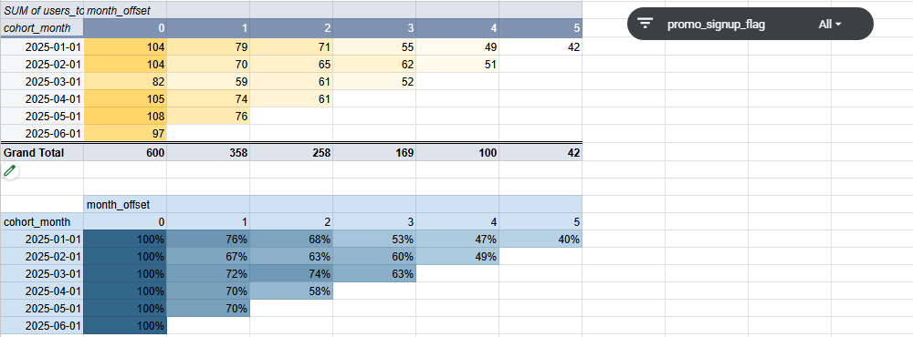
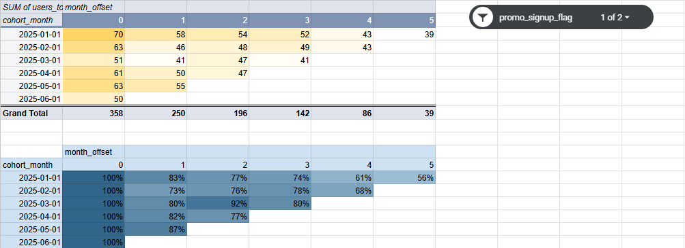
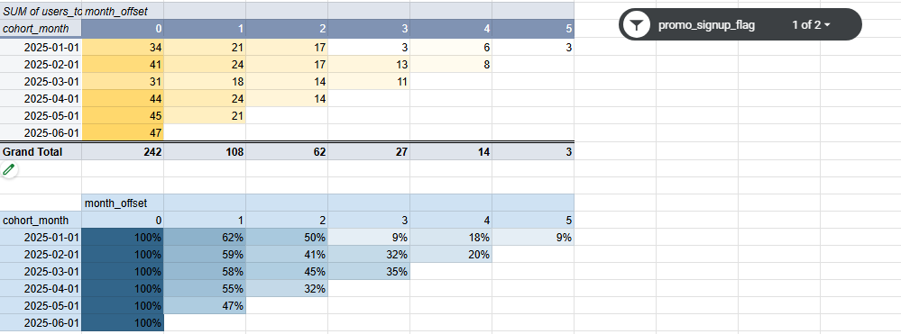

# Cohort Analysis: User Retention

**SQL | PostgreSQL | Google Sheets | Product Analytics**

## Project Overview

This project analyzes user retention through monthly cohort analysis, with a focus on comparing organic and promotional user acquisition.

The objective is to understand how user activity changes over time, identify retention patterns, and evaluate differences between Organic and Promo Users.

SQL was used to prepare and aggregate user activity data, while Google Sheets was used to calculate retention rates and build cohort tables.

**Analysis Period:** January – June 2025  
**Tools:** PostgreSQL, SQL, Google Sheets

## Cohort Analysis

[View Interactive Cohort Tables in Google Sheets](https://docs.google.com/spreadsheets/d/1YJC6jdDvOum5U468yGxbL0KVhZ9ui4A5ulUODn0nQEE/edit?gid=1431524392#gid=1431524392)

### Overall User Retention



### Organic User Retention



### Promo User Retention



## Business Questions

The analysis addresses the following questions:

1. How does user retention change over the months following registration?
2. How does retention vary between monthly registration cohorts?
3. Do Organic Users demonstrate different retention patterns from Promo Users?
4. At which stages of the user lifecycle does retention decline most noticeably?
5. What insights can support further investigation of user acquisition and engagement?

## Data Preparation and Methodology

The analysis was performed using two source tables:

- `cohort_users_raw` — user registration data and promotional signup indicators.
- `cohort_events_raw` — user activity events.

### SQL Data Preparation

The SQL workflow includes:

- Cleaning and standardizing date values with `TRIM`, `REGEXP_REPLACE`, and `TO_TIMESTAMP`.
- Converting registration and activity dates into a consistent format.
- Joining user registration records with activity events using `user_id`.
- Excluding records with missing registration dates, missing event dates, missing event types, and `test_event` entries.
- Assigning users to monthly registration cohorts.
- Calculating the number of months between registration and activity.
- Counting distinct active users by cohort, month offset, and acquisition segment.

The resulting dataset was used to create cohort tables in Google Sheets.

### Retention Rate Calculation

Users are grouped into cohorts based on their registration month.

**Month 0** represents the initial cohort period. Subsequent months represent user activity in later calendar months.

Retention Rate is calculated as:

**Retention Rate = Active Users in Month N / Users in Month 0 × 100%**

This is monthly retention based on user activity. A user can be inactive in one month and return in a later month.

## Key Findings

### Overall Retention

- Monthly registration cohorts generally contain approximately 100 users.
- The March cohort contains 82 users.
- Retention tends to decline over subsequent months, although individual cohorts may show temporary increases in activity.
- The January cohort records 40% retention in Month 5.

### Organic vs. Promo Retention

The comparison reveals higher observed retention among Organic Users than Promo Users.

For the January 2025 cohort:

| Month | Organic Retention | Promo Retention |
|---|---:|---:|
| Month 0 | 100% | 100% |
| Month 1 | 83% | 62% |
| Month 2 | 77% | 50% |
| Month 3 | 74% | 9% |
| Month 4 | 61% | 18% |
| Month 5 | 56% | 9% |

In Month 5, Organic Retention was **56%**, compared with **9%** for Promo Users — a difference of **47 percentage points**.

This suggests that organic and promotional signup groups exhibit different patterns of continued product activity.

The comparison is descriptive and does not establish that the promotional signup mechanism caused lower retention.

## Business Recommendations

Based on the observed retention patterns, the following actions could be considered:

- **Investigate promotional user engagement:** Examine why Promo Users demonstrate lower retention in later months.
- **Review the onboarding experience:** Identify opportunities to improve engagement after registration, particularly among promotional signups.
- **Monitor retention by cohort:** Track monthly cohorts to identify changes in user behavior over time.
- **Evaluate acquisition efficiency:** Combine retention findings with acquisition costs and customer value metrics before making marketing budget decisions.

## Tools and Technologies

| Tool | Purpose |
|---|---|
| PostgreSQL | Querying and processing user activity data |
| SQL | Date cleaning, joins, cohort assignment, and user aggregation |
| Google Sheets | Pivot tables, retention calculations, and cohort heatmaps |
| GitHub | Project documentation and SQL code sharing |

## Repository Structure

```text
Product-Analytics/
├── README.md
├── Product Analytics.sql
└── screenshots/
    ├── cohort_retention_overview.png
    ├── organic_retention.png
    └── promo_retention.png
```

## Project Summary

This project demonstrates practical skills in SQL data preparation, cohort analysis, user retention measurement, and product analytics.

The analysis highlights differences in user engagement between organic and promotional signup groups and provides a foundation for further investigation of retention and acquisition performance.
